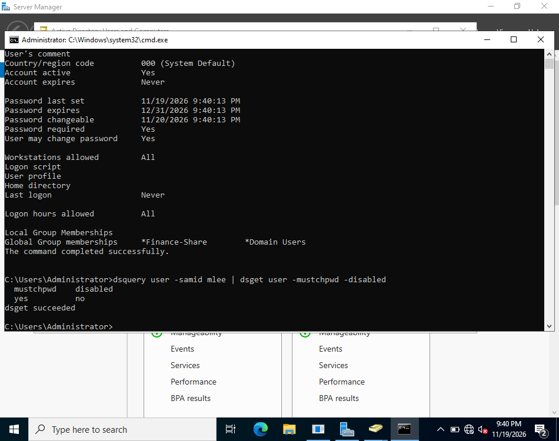

# Ticket 10: Suspected Phishing

**Scenario:** A user says they clicked a link in an email claiming their account would be closed, and entered their password.

## Questions to ask (calmly, no blame)
- When did you click it and what exactly did you enter? Which device? Any attachments? Is that password used elsewhere? Can you forward the email as an attachment or send a screenshot?

## Steps I took
1. **Reset the password immediately** in ADUC with **User must change password at next logon**.
2. Planned to review sign-in events for the account (Security log: **4624** successful, **4625** failed, **4740** lockout) for unusual times or machines.
3. Planned the report to Security: sender, subject, link, time, screenshots, and who else received it.

## Verification
- `net user` showed a password last-set time of today, and `dsget` showed `mustchpwd: yes`.
- The account showed `Last logon: Never`, so there was no sign-in activity in the lab to investigate.

## What I'd do on a real ticket
- Revoke the user's cloud sessions, check mailbox forwarding rules, and scan the device if anything was downloaded.
- **Report to Security** and let them search and remove the message from other mailboxes. Recommend a company-wide warning, but let Security or leadership send it.
- Follow up with the user and remind them how to spot phishing.

## Takeaway
Contain first (reset the password), then report, and let the right team handle company-wide actions.

## Evidence
*Verification output from the lab (screenshot).*

